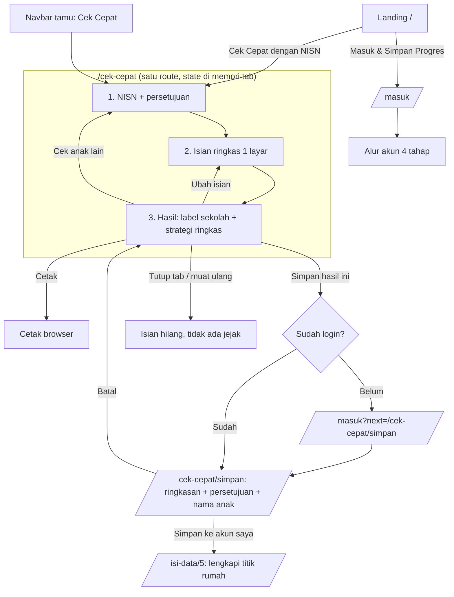
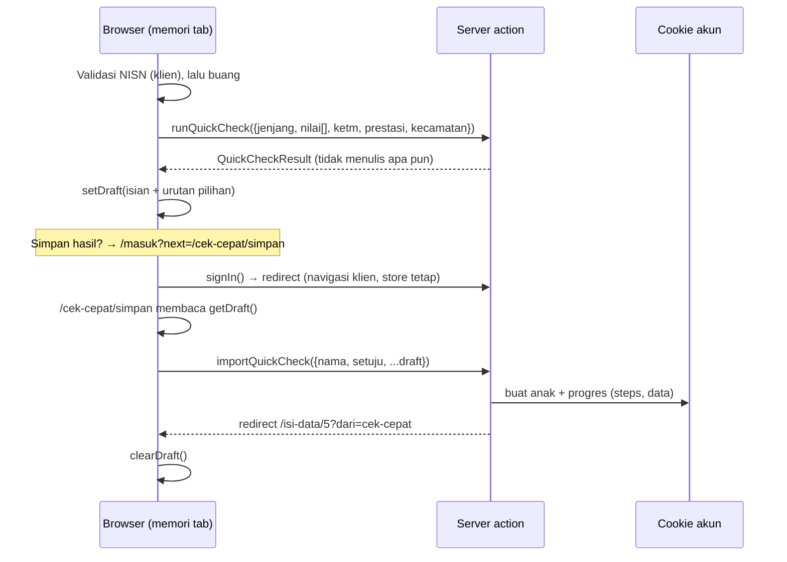

# Rencana Fitur: Cek Cepat (Tamu dengan NISN)

> Status: **menunggu persetujuan eksekusi**. Belum ada kode yang diubah.
> Dibuat: 30 Okt 2026. Keputusan pemilik produk: 1 = B, 2 = A, 3 = B (lihat bagian 2).
> Acuan: `moodboard/PRD.md` bagian 5.1, 6.2, 6.5, 6.6, 12; `docs/navigation-plan.md`.
> Kode yang jadi dasar: `src/lib/accounts.ts`, `src/proxy.ts`, `src/components/navbar/Navbar.tsx`,
> `src/components/shell/Shell.tsx`, `src/features/isi-data/*`, `src/data/schools.ts`.

---

## 1. Ringkasan

Orang tua bisa mengecek peluang anak **tanpa membuat akun**. Syaratnya memasukkan NISN anak dan menyetujui pernyataan singkat. Hasilnya berupa label peluang per sekolah dan strategi ringkas. **Tidak ada yang disimpan**: tidak di server, cookie, storage browser, riwayat URL, maupun log. Tutup tab atau muat ulang, hasil hilang.

Bila orang tua ingin menyimpan, ia masuk dengan OTP lalu **menyetujui secara eksplisit** pemindahan isian ke akun. Isian dibawa di memori tab saja, dan baru ditulis ke akun setelah tombol "Simpan ke akun saya" ditekan.

### Dua mode

| | **Cek Cepat (tamu)** | **Akun (login OTP)** |
|---|---|---|
| Syarat | NISN 10 digit + persetujuan | Nomor HP + OTP |
| Isian | 1 layar ringkas | Wizard 5 langkah |
| Hasil | Hasil Sekolah + Strategi ringkas + Cetak | 4 tahap: Data Anak, Hasil, Strategi, Dokumen |
| Detail sekolah, cadangan, checklist dokumen | Tidak | Ya |
| Penyimpanan | Tidak ada | Per anak, bisa dilanjutkan |
| Ubah urutan pilihan | Bisa dicoba, tidak tersimpan | Tersimpan |
| Banyak anak | Satu cek per kali | Beberapa profil |

---

## 2. Keputusan

| # | Pertanyaan | Keputusan | Akibat pada rancangan |
|---|---|---|---|
| 1 | Untuk apa NISN dipakai? | **B: hanya syarat masuk / penanda** | NISN tidak dipakai menghitung. NISN diperiksa formatnya **di browser** dan **tidak pernah dikirim ke server** (lihat 2.1). |
| 2 | Apa yang ditampilkan untuk tamu? | **A: Hasil Sekolah + Strategi ringkas + Cetak** | Detail sekolah, cadangan, dan checklist dokumen tetap khusus akun. Tautan ke halaman itu di hasil tamu diganti ajakan masuk. |
| 3 | Kalau tamu ingin menyimpan? | **B: pindahkan sekali setelah login, dengan persetujuan** | Isian dibawa di memori tab melewati login, lalu halaman konfirmasi meminta persetujuan sebelum ditulis ke akun. |

### 2.1 Penyimpangan dari PRD dan mitigasinya

PRD bagian 12 meminta "Jangan minta NIK/NISN bila tidak perlu". Keputusan 1B meminta NISN tanpa memakainya untuk menghitung. Supaya risikonya sekecil mungkin:

1. **NISN tidak meninggalkan browser.** Validasi format (10 digit angka) dilakukan di klien. Server action hitungan tidak menerima field NISN sama sekali.
2. **NISN tidak disimpan di mana pun**, termasuk di memori tab setelah langkah 1 selesai (variabel dibuang). Saat pindah ke akun (keputusan 3), NISN **tidak ikut dibawa**.
3. **Browser tidak mengingat NISN**: `autoComplete="off"`, tidak ada `name` yang bisa dipakai autofill, dan form tidak pernah dikirim lewat GET.
4. **NISN tidak tampil di halaman hasil**, judul, URL, atau pesan error.
5. Halaman menjelaskan alasannya dengan jujur: *"NISN hanya untuk memastikan Bapak/Ibu mengecek data siswa SMP. Kami tidak menyimpan dan tidak mengirim NISN."*

> **Tindak lanjut (di luar rencana ini):** catat penyimpangan ini di PRD bagian 12 setelah disetujui pemilik produk.

---

## 3. Lingkup

**Termasuk**
- Halaman `/cek-cepat` (3 langkah dalam satu route): NISN, isian ringkas, hasil.
- Model hitungan tiruan berbasis aturan yang hasilnya berubah sesuai isian.
- Halaman `/cek-cepat/simpan` untuk memindahkan isian ke akun setelah login.
- Isian wizard bisa terisi dari data yang dipindahkan (prefill).
- Perubahan navigasi: landing, navbar tamu, footer, halaman Masuk, proxy.
- Gaya cetak untuk halaman hasil.

**Tidak termasuk**
- Penarikan data dari NISN (keputusan 1B).
- Pembatas percobaan per IP. Karena NISN tidak dicek ke server, menebak NISN tidak menghasilkan apa pun, jadi pembatas tidak diperlukan dan malah akan membuat catatan IP.
- Analitik. Belum ada analitik di aplikasi; bila ditambah nanti, hanya hitungan anonim "1 cek cepat selesai".
- PDF dari server. Tamu memakai cetak browser.

---

## 4. Perjalanan pengguna

### 4.1 Langkah 1: NISN

- Judul: **Cek Cepat Peluang Anak**
- Deskripsi: *Tanpa akun, tanpa disimpan. Cocok untuk melihat gambaran peluang dalam 3 menit.*
- Field **NISN anak** (10 angka), petunjuk: *Ada di rapor atau kartu pelajar. Contoh: 0081234567.*
- Pilihan **"Saya mengerti hasil cek cepat tidak disimpan"** (wajib).
- Kotak info (Alert info): *NISN hanya untuk memastikan Bapak/Ibu mengecek data siswa SMP. Kami tidak menyimpan dan tidak mengirim NISN.*
- Tombol: **Lanjut** (utama), tautan **Lebih suka menyimpan progres? Masuk dengan nomor HP**.
- Pesan error:
  - Kosong: *NISN belum diisi. Lihat di rapor atau kartu pelajar anak.*
  - Format: *NISN terdiri dari 10 angka. Periksa lagi, termasuk angka 0 di depan.*

### 4.2 Langkah 2: Isian ringkas (satu layar)

Field dipilih supaya **setara 1:1 dengan field wizard**, agar bisa dipindahkan ke akun tanpa menebak.

| Field cek cepat | Wajib? | Komponen | Field wizard tujuan |
|---|---|---|---|
| Jenjang tujuan: SMA / SMK / Belum tahu | Ya (bawaan SMA) | `ChoiceGroup` radio | Langkah 1 `jenjang` |
| Nilai rata-rata semester 1–5 (5 kolom angka dalam satu baris, boleh kosong) | Tidak | `Field` angka, `inputMode="decimal"` | Langkah 2 semester 1–5 |
| Keluarga termasuk KETM / penerima bantuan? Ya / Tidak / Belum tahu + "Apa ini?" | Ya | `ChoiceGroup` + `HelpLink` | Langkah 3 |
| Prestasi lomba: tidak ada / kecamatan / kota / provinsi / nasional | Tidak | `Select` | Langkah 4 |
| Kecamatan tempat tinggal | Ya | `Select` dari `data/kecamatan.ts` | Langkah 5 (sebagian; titik rumah tetap diisi di wizard) |

- Tombol: **Lihat Peluang** (utama), **Kembali** (ke langkah 1, isian langkah 2 tetap).
- Nama anak **tidak diminta** di cek cepat (minimisasi data). Nama baru diminta saat menyimpan ke akun.

### 4.3 Langkah 3: Hasil

Urutan blok:
1. **Banner "tidak disimpan"** (Alert warning, tidak bisa ditutup): *Hasil ini tidak disimpan. Bila halaman ditutup atau dimuat ulang, Bapak/Ibu perlu mengisi ulang.*
2. **Ringkasan jalur**: jalur yang memenuhi syarat beserta alasan satu kalimat (misalnya "KETM: Ya, jadi Jalur Afirmasi bisa dipakai").
3. **Daftar sekolah berlabel** memakai `SchoolResultCard`. Tombol "Lihat detail" diganti teks *Detail sekolah tersedia setelah masuk*. Tombol "Tambah ke pilihan" tetap ada (mengubah strategi di memori).
4. **Strategi ringkas**: 3 pilihan (ambisius, seimbang, aman) memakai `RankList` dengan tombol naik/turun. Catatan: *Urutan bisa dicoba di sini, tetapi tidak tersimpan.*
5. **Disclaimer** standar (`Disclaimer`).
6. **Blok aksi** (`NextStep` / `CtaBand`):
   - **Simpan hasil ini ke akun** (utama), ke langkah simpan.
   - **Cetak** (sekunder), memanggil `window.print()`.
   - **Ubah isian** (ghost), kembali ke langkah 2.
   - **Cek anak lain** (ghost), mengosongkan semua state lalu ke langkah 1.
7. Teks kecil: *Sekolah cadangan dan checklist dokumen tersedia setelah masuk.*

### 4.4 Langkah simpan: `/cek-cepat/simpan` (hanya orang tua login)

- Bila draft di memori **ada**: ringkasan isian (tanpa NISN), field **Nama lengkap anak** (wajib), pilihan wajib **"Simpan data ini ke akun saya"**, tombol **Simpan ke akun saya** dan **Batal**.
- Bila draft **tidak ada** (tab dimuat ulang, atau dibuka langsung): *Data cek cepat sudah tidak ada di halaman ini. Bapak/Ibu bisa mengisi data anak dari awal.* Tombol **Mulai isi data anak**.
- Setelah simpan: draft dihapus dari memori, profil anak baru dibuat dan menjadi anak aktif, lalu diarahkan ke `/isi-data/5?dari=cek-cepat` dengan pesan *Data dari cek cepat sudah tersimpan. Tinggal tandai titik rumah.*

---

## 5. Aturan "tanpa jejak"

| # | Aturan | Cara | Cara uji |
|---|---|---|---|
| T1 | Isian hanya di memori tab | State React + store modul klien (`draft-store.ts`), tanpa `localStorage`, `sessionStorage`, IndexedDB, atau cookie | Setelah hasil tampil, `document.cookie`, `localStorage.length`, `sessionStorage.length` tidak bertambah |
| T2 | NISN tidak dikirim | NISN divalidasi di klien; `runQuickCheck` tidak punya field NISN | Periksa payload server action di DevTools Network: tidak ada 10 digit NISN |
| T3 | Tidak ada isian di URL | Semua langkah di satu route, transisi lewat state. Tidak ada `?nisn=`, `?nilai=` | Riwayat browser hanya berisi `/cek-cepat` |
| T4 | Server tidak menulis apa pun | `runQuickCheck` murni: menghitung lalu mengembalikan. Tidak ada `cookies().set`, `console.log` isi, atau penulisan berkas | Baca kode + `grep` log server setelah uji |
| T5 | Tidak di-cache | Proxy menambah `Cache-Control: no-store` dan `X-Robots-Tag: noindex` untuk `/cek-cepat*` | `curl -I` |
| T6 | Browser tidak mengingat isian | `autoComplete="off"` untuk NISN dan nilai | Uji manual: ketik ulang, tidak ada saran |
| T7 | Tidak memengaruhi dashboard kebijakan | Tidak ada data yang dikirim ke agregat | Baca kode |
| T8 | Peringatan sebelum kehilangan hasil | `beforeunload` aktif selama hasil tampil dan belum disimpan | Uji manual: muat ulang menampilkan dialog browser |
| T9 | Pemindahan ke akun hanya dengan persetujuan | Penulisan ke cookie akun hanya terjadi di aksi `importQuickCheck`, dan aksi itu menolak bila centang persetujuan tidak ada | Uji: tanpa centang, form tidak terkirim |

Batasan yang diketahui: bila login nanti memakai pengalihan ke situs lain (bukan OTP di halaman yang sama), memori tab hilang dan draft tidak terbawa. Untuk OTP sekarang, server action `signIn` melakukan navigasi di sisi klien, jadi store modul tetap ada.

---

## 6. Arsitektur

### 6.1 Berkas baru

| Berkas | Isi |
|---|---|
| `src/lib/quick-check.ts` | Tipe `QuickCheckInput`, `QuickCheckResult`, `QuickDraft`; `isValidNisn()` (klien); `estimate(input)` model tiruan murni; `draftToWizard(draft)` pemetaan ke langkah wizard |
| `src/lib/quick-check-actions.ts` | `"use server"`: `runQuickCheck(input)` (tanpa simpan) dan `importQuickCheck(form)` (menulis ke akun, butuh persetujuan) |
| `src/features/cek-cepat/draft-store.ts` | Store modul klien: `getDraft()`, `setDraft()`, `clearDraft()`. Tanpa storage browser |
| `src/features/cek-cepat/QuickCheck.tsx` | Komponen klien: mesin langkah `nisn → isian → hasil` |
| `src/features/cek-cepat/StepNisn.tsx`, `StepIsian.tsx`, `StepHasil.tsx` | Isi tiap langkah |
| `src/features/cek-cepat/SaveDraft.tsx` | Komponen klien untuk `/cek-cepat/simpan` |
| `src/app/(quick)/layout.tsx` | Cangkang fokus (`FocusChrome` varian cek cepat) |
| `src/app/(quick)/cek-cepat/page.tsx` | Server page: metadata + `<QuickCheck />` |
| `src/app/(quick)/cek-cepat/simpan/page.tsx` | Server page: metadata + `<SaveDraft />` |
| `src/styles/print.css` | Gaya cetak (sembunyikan navbar, footer, latar, tombol) |

### 6.2 Berkas yang diubah

| Berkas | Perubahan |
|---|---|
| `src/lib/accounts.ts` | `PUBLIC_PATHS` + `/cek-cepat`; `rolesFor("/cek-cepat/simpan") = ["orang-tua"]`; `Progress` mendapat field opsional `data` (isian per langkah); `buildSession` meneruskan `data` |
| `src/proxy.ts` | Header `no-store` + `noindex` untuk `/cek-cepat*` |
| `src/lib/session-actions.ts` | Helper internal untuk membuat anak + progres; dipakai `importQuickCheck` |
| `src/data/schools.ts` | Field angka untuk model tiruan: `rules: { kecamatan: string[]; prestasiMin?: number; afirmasiQuota: boolean }` per sekolah |
| `src/components/navbar/Navbar.tsx` | `FocusBar` jadi umum: `title`, `subtitle`, `progress?`, `exit: {href,label}`; varian tamu: tombol utama **Cek Cepat** |
| `src/components/shell/Shell.tsx` | `FocusChrome` menerima props baru; `continueFor` tidak berubah |
| `src/components/landing/LandingPage.tsx` + `src/app/(home)/page.tsx` | Hero dan CTA tamu: **Cek Cepat dengan NISN** + **Masuk & Simpan Progres** |
| `src/components/footer/Footer.tsx` | Tamu: "Mulai Cek Peluang" diganti "Cek Cepat dengan NISN" |
| `src/app/(public)/masuk/page.tsx` | Kartu "Belum ingin membuat akun? Cek Cepat"; alert khusus bila `next=/cek-cepat/simpan` |
| `src/features/isi-data/steps/*.tsx` + `src/app/(wizard)/isi-data/[langkah]/page.tsx` | Field menerima nilai awal dari `session.child.data`; banner `?dari=cek-cepat` |
| `src/components/field/Field.tsx`, `Select.tsx` | Dukungan `defaultValue` bila belum ada |
| `docs/navigation-plan.md` | Tambah mode tamu di bagian 2, 3, 4 |

### 6.3 Alur data

### 6.4 Model hitungan tiruan (`estimate`)

Data contoh sekarang statis untuk Dimas. Cek cepat butuh hasil yang **berubah sesuai isian**, jadi dipakai aturan sederhana. Semua hasil diberi tanda perkiraan dan disclaimer, sesuai PRD 7.3.

| Jalur | Memenuhi syarat bila | Label |
|---|---|---|
| Domisili | Kecamatan diisi | Aman bila kecamatan termasuk `rules.kecamatan` sekolah; Bersaing bila kecamatan bertetangga; Berisiko selain itu |
| Prestasi | Ada minimal 3 nilai semester, atau prestasi ≥ kota | Rata-rata ≥ `prestasiMin + 2`: Aman; selisih −2 sampai +2: Bersaing; di bawah: Berisiko. Prestasi provinsi/nasional menaikkan satu tingkat |
| Afirmasi | KETM = Ya | Aman bila sekolah punya kuota afirmasi; KETM = Belum tahu: tampil sebagai "mungkin, cek dokumen dulu" |
| Mutasi | Tidak dihitung di cek cepat | Teks: *Jalur Mutasi perlu dokumen penugasan; cek lewat akun.* |

- Per sekolah, label yang dipakai adalah jalur dengan label terbaik.
- Strategi ringkas: 1 Bersaing tertinggi (ambisius), 1 Aman terdekat (seimbang), 1 Aman lain (aman). Bila Aman kurang dari 2, tampil pesan *Peluang negeri masih kecil. Masuk untuk melihat sekolah cadangan.*
- Rentang ditampilkan seperti alur akun (misalnya "sekitar 70–85%"), dari tabel label ke rentang yang tetap.
- Nilai kosong semua dan prestasi tidak ada: jalur Prestasi ditampilkan *Belum cukup data untuk memperkirakan*.

---

## 7. Navigasi dan akses

### 7.1 Tabel akses (tambahan untuk `docs/navigation-plan.md` bagian 3)

| Halaman | Tamu | Orang tua | Kebijakan | Admin |
|---|---|---|---|---|
| `/cek-cepat` | Ya | Ya + banner | Ya | Ya |
| `/cek-cepat/simpan` | Ke `/masuk?next=/cek-cepat/simpan` | Ya | 403 | 403 |

Banner untuk orang tua yang sudah login: *Hasil cek cepat tidak masuk ke akun. Untuk menyimpan, pakai tombol "Simpan hasil ini ke akun" atau buka Data Anak.*

### 7.2 Header di `/cek-cepat` (mode fokus)

| Posisi | Isi |
|---|---|
| Kiri | Logo (tautan ke `/`, karena tidak ada progres akun yang bisa hilang selain hasil yang sudah diperingatkan) |
| Tengah | **Cek Cepat** · *tidak disimpan* · bar progres 3 segmen |
| Kanan | **Bantuan** (WhatsApp) · **Selesai** ke `/` |

### 7.3 Titik masuk

| Tempat | Tamu | Orang tua login |
|---|---|---|
| Navbar | Masuk (teks) + **Cek Cepat** (utama) | Tidak berubah |
| Landing hero | **Cek Cepat dengan NISN** + **Masuk & Simpan Progres**; baris kecil: *Cek cepat: tanpa akun, tidak disimpan · Masuk: progres tersimpan, bisa beberapa anak* | Tidak berubah ("Lanjutkan: [nama]") |
| Landing CTA | Sama dengan hero | Tidak berubah |
| Footer kolom Panduan | **Cek Cepat dengan NISN** | **Data Anak** |
| Halaman Masuk | Kartu *Belum ingin membuat akun? Cek Cepat dengan NISN →* | (dialihkan) |
| Halaman Panduan dan Tanya Jawab | `CtaBand` di bawah: dua tombol yang sama dengan hero | Tidak berubah |

Penyimpangan dari board FigCraft: tombol "Lihat Cara Kerja" di hero tamu diganti "Masuk & Simpan Progres". Board hanya punya dua tombol, dan dua pilihan cara cek lebih penting untuk orang tua daripada tautan gulir.

---

## 8. Daftar tugas

Kerjakan berurutan. Setiap tugas punya kriteria selesai. Centang di berkas ini saat tugas selesai.

### Fase A: Model dan aturan tanpa jejak

- [x] **A1. Tipe dan validasi.** `src/lib/quick-check.ts`: `QuickCheckInput` (tanpa NISN), `QuickDraft` (input + urutan pilihan), `QuickCheckResult`, `isValidNisn(v) = /^\d{10}$/.test(v)`.
  - Selesai bila: typecheck lolos; `isValidNisn("0081234567") === true`, `"12345"` dan `"00812345a7"` false.
- [x] **A2. Data aturan sekolah.** Tambah `rules` ke 5 sekolah di `data/schools.ts` dengan kecamatan dari `data/kecamatan.ts`.
  - Selesai bila: setiap sekolah punya `rules`; tidak ada perubahan tampilan alur akun.
- [x] **A3. `estimate(input)`.** Fungsi murni sesuai bagian 6.4.
  - Selesai bila: 4 contoh berikut memberi hasil yang diharapkan (diuji lewat skrip `node --experimental-strip-types` atau halaman uji sementara yang dihapus setelahnya):
    1. Kecamatan Harapan Jaya, nilai kosong, KETM Tidak: SMAN 5 Aman lewat Domisili; Prestasi "Belum cukup data".
    2. Kecamatan jauh, rata-rata 92, prestasi kota: SMAN 2 minimal Bersaing lewat Prestasi.
    3. KETM Ya: jalur Afirmasi muncul di ringkasan.
    4. Kecamatan jauh, nilai rendah, KETM Tidak: pesan "Peluang negeri masih kecil".
- [x] **A4. `runQuickCheck`.** Server action yang memvalidasi input (tipe, rentang nilai 0–100, kecamatan dikenal) lalu memanggil `estimate`. Tidak menulis cookie, berkas, atau log.
  - Selesai bila: `grep -n "cookies\|console\|writeFile" src/lib/quick-check-actions.ts` hanya menemukan pemakaian di `importQuickCheck`.
- [x] **A5. Proxy.** `/cek-cepat` publik; `/cek-cepat/simpan` untuk orang tua; header `Cache-Control: no-store` dan `X-Robots-Tag: noindex` untuk `/cek-cepat*`.
  - Selesai bila: `curl -I /cek-cepat` menampilkan kedua header; tamu ke `/cek-cepat/simpan` → 307 ke `/masuk?next=%2Fcek-cepat%2Fsimpan`; Pembuat Kebijakan → `/akses-ditolak`.

### Fase B: Halaman Cek Cepat

- [x] **B1. Cangkang fokus.** Generalisasi `FocusBar` (bagian 7.2) tanpa mengubah tampilan wizard. Route group `(quick)` dengan layout memakai `FocusChrome` varian cek cepat.
  - Selesai bila: header wizard tampil sama seperti sebelumnya; header `/cek-cepat` menampilkan "Cek Cepat · tidak disimpan" dan tombol Selesai.
- [x] **B2. Langkah NISN** sesuai 4.1. NISN di state lokal komponen, dibuang setelah valid.
  - Selesai bila: dua pesan error tampil sesuai kasus; setelah Lanjut, tidak ada NISN di state React (cek React DevTools) maupun DOM.
- [x] **B3. Langkah isian** sesuai 4.2, memakai `Form`, `Field`, `ChoiceGroup`, `Select`, `HelpLink`.
  - Selesai bila: Kembali lalu Lanjut mempertahankan isian; field wajib kosong menampilkan pesan bergaya PRD bagian 11.
- [x] **B4. Langkah hasil** sesuai 4.3, memakai `SchoolResultCard`, `RankList`, `Disclaimer`, `Alert`, `CtaBand`.
  - Selesai bila: hasil berubah saat isian diubah; tombol naik/turun mengubah urutan; tidak ada tautan ke `/detail-sekolah` atau `/cadangan` untuk tamu.
- [x] **B5. Cek anak lain dan Ubah isian.** Cek anak lain mengosongkan state dan draft store; Ubah isian kembali ke langkah 2 dengan isian lama.
- [x] **B6. `beforeunload`.** Aktif hanya saat langkah 3 tampil, dan nonaktif setelah klik Simpan atau Cek anak lain.
- [x] **B7. Gaya cetak.** `print.css`: sembunyikan navbar, header fokus, footer, latar, tombol, dan banner; tampilkan judul "Hasil Cek Cepat SIPESEK" + tanggal + disclaimer.
  - Selesai bila: pratinjau cetak (Chrome `--print-to-pdf`) memuat daftar sekolah, strategi, dan disclaimer, tanpa navbar dan tombol.
- [x] **B8. Banner untuk orang tua login** di `/cek-cepat` (bagian 7.1).

### Fase C: Pindah ke akun

- [x] **C1. Draft store.** `draft-store.ts` berupa variabel modul klien. Ditulis saat tombol "Simpan hasil ini ke akun" diklik, tidak sebelumnya.
  - Selesai bila: tidak ada pemakaian `localStorage`, `sessionStorage`, `indexedDB`, atau `document.cookie` di folder `features/cek-cepat` (`grep`).
- [x] **C2. Tombol Simpan.** Tamu: `router.push("/masuk?next=/cek-cepat/simpan")`. Orang tua login: langsung ke `/cek-cepat/simpan`.
- [x] **C3. Halaman Masuk.** Alert khusus bila `next=/cek-cepat/simpan`: *Masuk dulu untuk menyimpan hasil cek cepat. Isian Bapak/Ibu masih ada di tab ini; jangan muat ulang halaman.* Pastikan `signIn` mengarah ke `next` itu (sudah lewat `safeNext`).
  - Selesai bila: setelah OTP, browser tiba di `/cek-cepat/simpan` tanpa muat ulang penuh, dan draft masih ada.
- [x] **C4. Halaman simpan** sesuai 4.4, termasuk keadaan "draft tidak ada".
- [x] **C5. `importQuickCheck`.** Validasi `setuju === "ya"` dan nama tidak kosong; buat id anak baru; tulis progres `{ steps: 4, name, data: draftToWizard(draft) }`; jadikan anak aktif; redirect ke `/isi-data/5?dari=cek-cepat`.
  - Selesai bila: tanpa centang, aksi menolak dan tidak menulis cookie; dengan centang, Data Anak menampilkan anak baru di "langkah 5 dari 5".
- [x] **C6. Prefill wizard.** Langkah 1–5 membaca nilai awal dari `session.child.data`; `Field`/`Select` mendukung `defaultValue`; langkah 5 memilih kecamatan dari data; banner `?dari=cek-cepat` di langkah 5.
  - Selesai bila: setelah impor, kembali ke langkah 2 menampilkan nilai semester yang diisi di cek cepat; NISN tidak muncul di mana pun.
- [x] **C7. Bersihkan draft.** `clearDraft()` setelah impor berhasil dan saat Batal.

### Fase D: Navigasi dan konten

- [x] **D1. Navbar tamu**: tombol utama **Cek Cepat** ke `/cek-cepat`; panel HP menampilkan Cek Cepat dan Masuk.
- [x] **D2. Landing** (hero, baris penjelas, CTA) untuk tamu sesuai 7.3; alur login tidak berubah.
- [x] **D3. Footer**: kolom Panduan sesuai 7.3.
- [x] **D4. Halaman Masuk**: kartu "Belum ingin membuat akun?".
- [x] **D5. Panduan dan Tanya Jawab**: `CtaBand` dua tombol untuk tamu. Tambah 2 FAQ di `data/faq.ts`:
  - *Apa beda Cek Cepat dan masuk dengan akun?*
  - *Apakah NISN anak disimpan?*: *Tidak. NISN hanya diperiksa di HP Bapak/Ibu dan tidak dikirim ke server kami.*
- [x] **D6. Dokumentasi**: perbarui `docs/navigation-plan.md` bagian 2–4 dan tabel akses; catat penyimpangan PRD (bagian 2.1) di bagian Catatan.

### Fase E: Verifikasi

- [x] **E1.** `npm run typecheck` dan `npm run build` lolos.
- [ ] **E2. Tabel akses** (bagian 7.1) diuji dengan `curl` untuk 4 peran.
- [ ] **E3. Uji tanpa jejak** (bagian 5, T1–T9). Hasil dicatat di tabel bagian 9.
- [ ] **E4. Skenario** dengan screenshot 1440 px dan 390 px:
  1. Tamu: landing → Cek Cepat → NISN salah (error) → NISN benar → isian → hasil → ubah urutan → Cetak.
  2. Tamu: hasil → Simpan → Masuk (OTP) → halaman simpan → tanpa centang (ditolak) → dengan centang → wizard langkah 5 terisi kecamatan → kembali ke langkah 2 nilai terisi.
  3. Tamu: hasil → muat ulang → isian kosong (dan dialog `beforeunload` muncul sebelumnya).
  4. Orang tua login: `/cek-cepat` menampilkan banner; menyelesaikan cek cepat tidak mengubah daftar anak sampai Simpan.
  5. Buka `/cek-cepat/simpan` langsung setelah login: tampil keadaan "draft tidak ada".
- [ ] **E5. Aksesibilitas**: urutan fokus per langkah benar; fokus pindah ke judul langkah saat berganti langkah; pesan error terbaca (`aria-describedby`); kontras ≥ 4,5:1 untuk teks baru.
- [x] **E6.** `graphify update .` dan `.workflow/state.md` diperbarui.

> Catatan metode uji: E3 dan E4 butuh browser yang bisa menjalankan skrip (cek cookie/storage, isi form). Sebelumnya pembuatan skrip CDP di `/tmp` ditolak. Saat eksekusi, saya akan meminta izin sekali untuk skrip uji; bila tidak diizinkan, E3 dan E4 dijalankan sebagai checklist manual di bagian 9 dan diisi oleh penguji.

---

## 9. Lembar hasil verifikasi (diisi saat eksekusi)

| ID | Uji | Hasil | Catatan |
|---|---|---|---|
| T1 | Cookie dan storage tidak bertambah | | |
| T2 | NISN tidak ada di payload server action | | |
| T3 | URL dan riwayat tanpa isian | | |
| T4 | Server action cek cepat tidak menulis apa pun | | |
| T5 | Header `no-store` + `noindex` | | |
| T6 | Tidak ada saran autofill NISN | | |
| T8 | Dialog `beforeunload` | | |
| T9 | Impor ditolak tanpa persetujuan | | |
| E4.1–E4.5 | Skenario | | |

---

## 10. Risiko

| Risiko | Dampak | Penanganan |
|---|---|---|
| Orang tua memuat ulang halaman Masuk saat menyimpan | Draft hilang | Alert di halaman Masuk (C3); halaman simpan menjelaskan dan menawarkan mulai dari awal (C4) |
| Login nanti memakai pengalihan ke situs lain | Draft tidak terbawa | Dicatat di bagian 5; solusi masa depan perlu keputusan baru (misalnya draft terenkripsi dengan persetujuan) |
| Hasil tiruan dianggap akurat | Kepercayaan salah | Disclaimer, rentang (bukan angka tunggal), label "perkiraan", sesuai PRD 7.3 |
| NISN diminta tapi tidak dipakai (penyimpangan PRD 12) | Kritik privasi | Mitigasi bagian 2.1 dan FAQ yang jujur |
| Halaman hasil panjang di HP | Orang tua tersesat | Urutan blok tetap (4.3), tombol aksi di akhir, banner "tidak disimpan" di atas |

## 11. Cara mundur (rollback)

Fitur terisolasi di route group `(quick)` dan `features/cek-cepat`. Untuk menonaktifkan:
1. Hapus `src/app/(quick)`.
2. Kembalikan tombol tamu di Navbar, Landing, Footer, dan Masuk ke "Mulai Cek Peluang" → `/masuk`.
3. Hapus `/cek-cepat` dari `PUBLIC_PATHS` dan `rolesFor`.
Prefill wizard (C6) dan field `data` di progres boleh tetap ada karena tidak mengubah perilaku tanpa data.

## 10. Catatan pelaksanaan (deviasi dari rencana)
- Tombol "Tambah ke Pilihan" tidak ada di hasil tamu (B4); diganti teks "Detail sekolah tersedia setelah masuk".
- "Batal" di `/cek-cepat/simpan` kembali ke `/cek-cepat` dan menghapus draf (hasil tidak bisa dipulihkan).
- "Kembali" dari isian ke langkah NISN meminta NISN diketik ulang (NISN dibuang setelah langkah 1).
- Terverifikasi (curl): header `no-store` + `noindex` di `/cek-cepat`, tanpa Set-Cookie, tamu di `/cek-cepat/simpan` → 307 `/masuk?next=...`, kebijakan → `/akses-ditolak`, orang tua → 200. Screenshot langkah NISN 1440 dan 390 sesuai.
- Belum diuji interaktif di browser: alur NISN → isian → hasil, simpan ke akun, uji tanpa jejak T1–T9, aksesibilitas (E3–E5).

## 11. Fase F: Domisili akurat (jarak ke sekolah, dihitung di browser)
Keputusan: opsi B. Titik rumah ditandai di peta atau lewat GPS browser; jarak ke sekolah dihitung di browser.

**Perubahan keputusan sebelumnya**
- `runQuickCheck` (server action) dihapus. `estimate` kini dipanggil langsung di browser, jadi titik rumah tidak pernah menjadi payload apa pun. T2/T4 makin kuat: Cek Cepat tidak memanggil server sama sekali, kecuali `importQuickCheck` saat menyimpan.
- Kecamatan tetap diisi sebagai cadangan bila titik rumah tidak ditandai (jarak dihitung dari pusat kecamatan, ditandai "kasar"). Cadangan kelurahan (opsi A) tidak dibuat karena belum ada data kelurahan.
- Titik rumah tidak ikut ke akun. Yang dipindahkan hanya kecamatan terdekat; orang tua menandai titik lagi di langkah 5. `importQuickCheck` menolak payload yang berisi `lokasi`.

**Berkas**
| Berkas | Isi |
|---|---|
| `src/data/geo.ts` (baru) | Titik acuan, `at()`, `distanceKm()`, batas wilayah, proyeksi peta skematis, pusat kecamatan, lokasi sekolah (semua DATA CONTOH), `nearestKecamatan()` |
| `src/data/schools.ts` | `SchoolRules.neighbors` diganti `radiusKm` (perkiraan radius zona domisili tahun lalu) |
| `src/lib/quick-check.ts` | `QuickCheckInput.lokasi`; domisili dinilai dari jarak: ≤ 0,7× radius Aman, ≤ 1,2× Bersaing, selebihnya Berisiko; fakta "Jarak rumah" dan "Perkiraan zona tahun lalu"; catatan bila titik belum ditandai |
| `src/features/cek-cepat/HomePicker.tsx` (baru) | Peta skematis (tanpa ubin dari server pihak ketiga), tap/klik menaruh pin, panah keyboard menggeser 0,25 km, tombol "Gunakan lokasi saya", pesan bila izin ditolak atau di luar wilayah |
| `src/features/cek-cepat/QuickCheck.tsx` | Memakai `HomePicker`; `lokasi` hanya di state; draf menyimpan `lokasi: null` |

**Tugas**
- [x] F1. Data geografi contoh dan fungsi jarak (`geo.ts`).
- [x] F2. Model domisili berbasis jarak dengan jalur cadangan kecamatan.
- [x] F3. Komponen `HomePicker` (peta, GPS, keyboard, pesan galat).
- [x] F4. Hitung di browser; hapus `runQuickCheck`; `importQuickCheck` menolak `lokasi`.
- [x] F5. Typecheck, build, uji unit `estimate` (5 kasus: dekat/jauh/di luar wilayah/tanpa titik).
- [ ] F6. Uji interaktif di browser: tap peta, GPS (izin ditolak, di luar wilayah), panah keyboard, tanpa permintaan jaringan saat menaruh pin (DevTools Network), `localStorage`/cookie tidak berubah.
- [ ] F7. Ganti koordinat sekolah, pusat kecamatan, dan radius zona dengan data resmi dinas.

**Batasan**
- Jarak lurus, bukan jarak rute atau zona resmi. Hasil tetap berlabel perkiraan.
- GPS hanya diterima di dalam wilayah layanan; di luar itu pengguna diminta menandai peta. Dengan data contoh, GPS di lokasi nyata hampir selalu di luar wilayah.
- Syarat usia Kartu Keluarga tidak bisa dihitung dari NISN.
