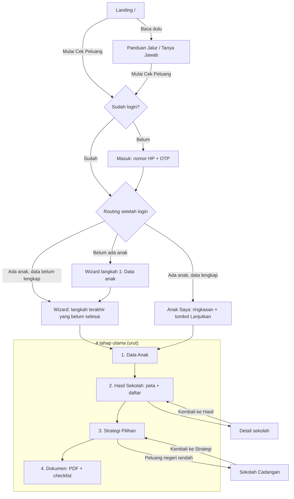

# Rencana Perbaikan Navigasi SIPESEK

> Status: **selesai dieksekusi** (29 Okt 2026). Keputusan bagian 6 memakai usulan default.
> Acuan: `moodboard/PRD.md` bagian 4 (Arsitektur Informasi), 5.1 (Alur orang tua), 6.2 (Wizard), 9.6 (Responsif).
> Asumsi: autentikasi sudah ada. Implementasi memakai sesi tiruan (mock) yang bisa diganti backend nanti.

---

## 1. Masalah di navigasi sekarang

Temuan dari kode saat ini (`src/lib/nav.ts`, `Navbar.tsx`, `BottomNav.tsx`, halaman di `src/app`):

| # | Masalah | Dampak ke orang tua |
|---|---|---|
| M1 | Navbar publik punya **Peta Sekolah** dan ikon cari yang membuka `/peta-sekolah`. Halaman itu sudah berisi hasil pribadi "Dimas Pratama". | Tamu melihat hasil anak orang lain dan tidak paham kenapa. |
| M2 | Navbar orang tua berisi 5 menu datar (Anak Saya, Peta Sekolah, Strategi, Unduhan, Bantuan) tanpa urutan. | Orang tua tidak tahu harus ke mana dulu. Strategi bisa dibuka padahal data belum lengkap. |
| M3 | Tidak terlihat **anak mana** yang sedang dilihat, dan tidak ada cara ganti anak dari navbar. | Orang tua dengan 2 anak bisa salah membaca hasil. |
| M4 | Navigasi bawah HP berisi Beranda, Anak Saya, Peta, Strategi. **Beranda** membuka landing publik. Unduhan tidak ada. Isinya beda dengan navbar atas. | Sekali ketuk, orang tua keluar dari area akun ke landing. |
| M5 | Setelah OTP, semua orang tua dikirim ke `/anak-saya`, termasuk akun baru tanpa anak. | Pengguna baru bertemu halaman kosong, bukan wizard. |
| M6 | Wizard (`/isi-data/*`) menampilkan navbar penuh. Langkah terakhir mengarah ke `/peta-sekolah`, dan tidak ada langkah berikutnya yang jelas menuju Strategi. | Orang tua mudah keluar di tengah pengisian. Alur PRD (hasil, lalu strategi, lalu unduh) terputus. |
| M7 | Breadcrumb tidak konsisten. Panduan dan Tanya Jawab punya "Beranda >" padahal halaman tingkat atas. Unduhan tidak punya breadcrumb. Cadangan ada di bawah Strategi tapi tidak bisa dicapai dari menu. | Orang tua tidak tahu posisinya. |
| M8 | Footer publik menautkan halaman khusus akun (`/cadangan`, `/masuk` untuk "Simulasi"). | Tamu masuk ke halaman yang butuh login. |
| M9 | Orang tua yang sudah login lalu membuka `/` tetap melihat navbar tamu ("Mulai Cek Peluang"). | Terasa seperti belum login dan harus mulai dari awal. |
| M10 | Istilah campur: "PPDB" (breadcrumb, judul), "SPMB" (PRD, landing), "Panduan PPDB" vs "Panduan Jalur". | Orang tua bingung apakah ini dua hal berbeda. |
| M11 | Dashboard kebijakan dan admin hanya menampilkan logo dan Keluar. Tidak ada nama peran atau pengguna. | Staf tidak yakin sedang di akun yang benar. |

---

## 2. Roadmap perjalanan orang tua

### 2.1 Gambaran besar

### 2.2 Aturan perjalanan

1. **Satu jalur utama, empat tahap.** Navigasi orang tua mengikuti urutan PRD 5.1: Data Anak, Hasil Sekolah, Strategi, Dokumen. Menu memakai urutan ini dan diberi nomor.
2. **Tahap terkunci sampai syaratnya terpenuhi.**
   - Hasil Sekolah terbuka setelah data wajib terisi (titik rumah + jenjang).
   - Strategi terbuka setelah Hasil Sekolah ada.
   - Dokumen terbuka setelah ada minimal 1 pilihan sekolah.
   - Menu terkunci tetap terlihat, dengan ikon gembok dan teks "Lengkapi data anak dulu". Bila diklik, orang tua diarahkan ke langkah yang kurang, bukan halaman error.
3. **Setiap halaman tahap diakhiri tombol "Langkah berikutnya"** ke tahap selanjutnya. Orang tua tidak perlu kembali ke navbar.
4. **Halaman turunan** (Detail sekolah, Sekolah Cadangan) tidak masuk menu. Halaman ini punya tombol kembali yang jelas ke tahap induknya.
5. **Wizard memakai mode fokus.** Selama mengisi data, menu utama disembunyikan. Yang tampil hanya logo, progres "Langkah x dari 5", **Simpan & keluar**, dan **Bantuan**.
6. **Konteks anak selalu terlihat.** Nama anak aktif tampil di navbar. Ganti anak lewat pemilih di navbar.

### 2.3 Routing setelah login (`/masuk`)

| Kondisi akun | Tujuan |
|---|---|
| Ada parameter `?next=` yang valid (halaman dalam area yang sama) | Halaman `next` |
| Peran Pembuat Kebijakan | `/kebijakan-ringkasan` |
| Peran Admin | `/admin-aturan` |
| Orang tua, belum ada anak | `/isi-data/1` |
| Orang tua, 1 anak, data belum lengkap | Langkah wizard pertama yang belum selesai |
| Orang tua, data lengkap atau lebih dari 1 anak | `/anak-saya` |

---

## 3. Hak akses: tamu vs sudah login

| Halaman | Tamu | Orang tua | Pembuat Kebijakan | Admin |
|---|---|---|---|---|
| `/` Landing | Ya | Ya (navbar versi login) | Ya | Ya |
| `/panduan` Panduan Jalur | Ya | Ya | Ya | Ya |
| `/tanya-jawab` | Ya | Ya | Ya | Ya |
| `/masuk` | Ya | Dialihkan ke routing 2.3 | Dialihkan | Dialihkan |
| `/anak-saya` | Ke `/masuk?next=` | Ya | Tidak (403) | Tidak (403) |
| `/isi-data/[langkah]` | Ke `/masuk?next=` | Ya | Tidak | Tidak |
| `/peta-sekolah` (Hasil Sekolah) | Ke `/masuk?next=` | Ya, bila tahap terbuka | Tidak | Tidak |
| `/detail-sekolah/[id]` | Ke `/masuk?next=` | Ya | Tidak | Tidak |
| `/strategi`, `/cadangan` | Ke `/masuk?next=` | Ya, bila tahap terbuka | Tidak | Tidak |
| `/unduhan` (Dokumen) | Ke `/masuk?next=` | Ya, bila tahap terbuka | Tidak | Tidak |
| `/kebijakan-*` | Ke `/masuk?next=` | Tidak (403) | Ya | Ya (lihat saja) |
| `/admin-*` | Ke `/masuk?next=` | Tidak (403) | Tidak (403) | Ya |

Catatan:
- "Tidak (403)" menampilkan halaman ramah: "Halaman ini untuk petugas dinas. Kembali ke Anak Saya."
- Admin boleh melihat dashboard kebijakan. Ini usulan, perlu keputusan (lihat bagian 6).

---

## 4. Isi navbar per keadaan

### 4.1 Tamu (belum login)

| Posisi | Isi |
|---|---|
| Kiri | Logo Sipesek → `/` |
| Tengah | Beranda · Panduan Jalur · Tanya Jawab |
| Kanan | **Masuk** (tombol teks) · **Mulai Cek Peluang** (tombol utama) |
| HP | Logo + Mulai Cek Peluang + tombol menu (Beranda, Panduan Jalur, Tanya Jawab, Masuk) |

Dihapus: Peta Sekolah dan ikon cari (M1). Board FigCraft menampilkan keduanya; ini penyimpangan sadar dari board demi alur PRD. Tidak ada navigasi bawah untuk tamu.

### 4.2 Orang tua sudah login, di halaman publik (`/`, `/panduan`, `/tanya-jawab`)

Sama dengan tamu, tetapi area kanan diganti:
- **Lanjutkan: [nama anak]** (tombol utama) → tahap terakhir yang dikunjungi.
- Menu akun (avatar inisial) berisi: Anak Saya, Keluar.

### 4.3 Orang tua di area akun

| Posisi | Isi |
|---|---|
| Kiri | Logo → `/anak-saya` |
| Tengah | **1 Data Anak · 2 Hasil Sekolah · 3 Strategi · 4 Dokumen** (urut, bernomor, tahap terkunci bergembok) |
| Kanan | **Pemilih anak** ("Dimas ▾": daftar anak + Tambah anak) · **Menu akun**: Panduan Jalur, Tanya Jawab, Butuh bantuan (WhatsApp), Keluar |
| HP atas | Logo + pemilih anak + menu akun |
| HP bawah (navigasi bawah) | Anak · Hasil · Strategi · Dokumen (4 item, sama dengan menu tengah). Beranda publik dihapus (M4). |

"Data Anak" membuka `/anak-saya`. Dari sana orang tua masuk ke wizard. Menu Bantuan pindah ke menu akun supaya menu utama hanya berisi 4 tahap.

### 4.4 Orang tua di wizard (`/isi-data/*`), mode fokus

| Posisi | Isi |
|---|---|
| Kiri | Logo (tidak bisa diklik, supaya tidak keluar tanpa sengaja) |
| Tengah | "Data Dimas · Langkah 2 dari 5" + bar progres |
| Kanan | **Simpan & keluar** → `/anak-saya` · **Bantuan** |
| Bawah | Tidak ada navigasi bawah |

Halaman wizard tidak lagi memakai breadcrumb. Tombol Kembali/Lanjut tetap di bawah form.

### 4.5 Pembuat Kebijakan dan Admin

| Posisi | Isi |
|---|---|
| Navbar kiri | Logo → beranda peran |
| Navbar kanan | Label peran ("Pembuat Kebijakan" / "Admin") + nama pengguna + Keluar |
| Sidebar | Tetap seperti sekarang (`POLICY`, `ADMIN` di `nav.ts`) |
| Admin saja | Tautan sidebar tambahan "Lihat dashboard kebijakan" (bila disetujui) |

### 4.6 Breadcrumb dan tombol kembali

- Halaman tingkat atas (Landing, Panduan, Tanya Jawab, 4 tahap) **tidak** memakai breadcrumb. Navbar sudah menandai posisi.
- Halaman turunan memakai breadcrumb 2 tingkat yang dimulai dari tahap induk:
  - Detail sekolah: `Hasil Sekolah > SMA Negeri 5`
  - Sekolah Cadangan: `Strategi > Sekolah Cadangan`
- Di HP, breadcrumb diganti satu tautan "← Kembali ke Hasil Sekolah".

### 4.7 Istilah

Pakai **SPMB** di semua teks (bukan PPDB), sesuai PRD. Label menu final: Beranda, Panduan Jalur, Tanya Jawab, Data Anak, Hasil Sekolah, Strategi, Dokumen.

---

## 5. Daftar tugas (dieksekusi setelah disetujui)

Urutan disusun supaya tiap tugas bisa diuji sendiri. Semua perubahan memakai komponen dan token yang sudah ada.

### Fase A — Fondasi sesi dan akses

- [x] **A1. Sesi tiruan.** Buat `src/lib/session.ts`: tipe `Session = { role: "tamu" | "orang-tua" | "kebijakan" | "admin"; name; children: ChildSummary[]; activeChildId }`, dibaca dari cookie `sipesek_session`. Isi awal dari data contoh (Dimas, Nadia). Sediakan helper `getSession()` (server) dan `useSession()` (client).
  - Selesai bila: halaman server bisa membaca peran dan anak aktif tanpa hardcode nama.
- [x] **A2. Status tahap per anak.** Buat `src/lib/journey.ts`: `stageStatus(child) → { data, hasil, strategi, dokumen: "selesai" | "terbuka" | "terkunci" }` dan `nextIncompleteStep(child)`. Sumber data: field progres di data anak contoh (Dimas lengkap, Nadia langkah 2).
  - Selesai bila: fungsi mengembalikan status benar untuk Dimas dan Nadia.
- [x] **A3. Penjaga rute.** Tambah `src/proxy.ts` (nama middleware di Next 16; cek ulang dokumentasi saat eksekusi) untuk aturan tabel bagian 3: tamu ke `/masuk?next=`, peran salah ke halaman 403, `/masuk` saat sudah login ke routing 2.3.
  - Selesai bila: tiap baris tabel bagian 3 diuji dengan cookie peran berbeda.
- [x] **A4. Halaman 403.** Halaman ramah dengan tombol ke beranda peran.
- [x] **A5. Routing setelah login.** `MasukFlow` memakai aturan 2.3, bukan selalu `/anak-saya`. Untuk demo, sediakan pilihan peran di langkah OTP (hanya mode mock).
- [x] **A6. Keluar.** Tombol Keluar menghapus cookie lalu ke `/`.

### Fase B — Konfigurasi navigasi

- [x] **B1. Tulis ulang `src/lib/nav.ts`** jadi satu sumber: `GUEST_NAV`, `PARENT_STAGES` (4 tahap: href, label, nomor, ikon, kunci status), `ACCOUNT_MENU`, `POLICY`, `ADMIN`. Hapus `BOTTOM` terpisah; navigasi bawah memakai `PARENT_STAGES`.
- [x] **B2. Peta halaman ke tahap.** Perbarui `activeHref` supaya `/isi-data`, `/detail-sekolah`, `/cadangan` menandai tahap induk yang benar (Data Anak, Hasil Sekolah, Strategi). Hapus `activeBottom`.
- [x] **B3. Istilah.** Ganti "PPDB" jadi "SPMB" di teks yang tampil ke pengguna (judul, breadcrumb, metadata, data contoh). Nama variabel tidak diubah.

### Fase C — Komponen navbar

- [x] **C1. `Navbar` per keadaan.** Satu komponen dengan varian `guest | parent-public | parent | focus | staff`, mengikuti bagian 4.1–4.5. Varian dipilih dari sesi dan rute, bukan dari prop `area` yang ditulis manual.
- [x] **C2. Item tahap.** Item bernomor dengan tiga keadaan: aktif, selesai (centang), terkunci (gembok + `aria-disabled` + tooltip teks). Klik item terkunci mengarah ke `nextIncompleteStep`.
- [x] **C3. Pemilih anak.** Dropdown (keyboard + Esc) berisi daftar anak dengan status singkat dan "Tambah anak". Mengganti anak memperbarui cookie dan me-refresh halaman.
- [x] **C4. Menu akun.** Dropdown: Panduan Jalur, Tanya Jawab, Butuh bantuan (WhatsApp), Keluar.
- [x] **C5. Mode fokus wizard.** Header ringkas untuk `/isi-data/*` (bagian 4.4). Hapus duplikasi `Stepper` antara layout dan header.
- [x] **C6. Navigasi bawah HP.** `BottomNav` memakai 4 tahap yang sama, termasuk status terkunci. Tidak tampil di mode fokus dan untuk tamu.
- [x] **C7. Navbar staf.** Tambah label peran dan nama pengguna di `DashBar`.

### Fase D — Isi halaman yang mendukung alur

- [x] **D1. "Langkah berikutnya".** Tambah blok akhir halaman di Hasil Sekolah → Strategi, Strategi → Dokumen, Dokumen → "Selesai, kembali ke Anak Saya". Pakai komponen `CtaBand` yang ada.
- [x] **D2. Wizard selesai.** Langkah terakhir mengarah ke Hasil Sekolah anak tersebut, dengan pesan "Data Dimas lengkap. Ini hasilnya."
- [x] **D3. Anak Saya.** Tiap kartu anak menampilkan 4 tahap sebagai progres dan satu tombol "Lanjutkan: [tahap berikutnya]". Ganti data contoh hardcode dengan data dari sesi.
- [x] **D4. Breadcrumb.** Hapus dari Panduan dan Tanya Jawab. Detail sekolah dan Cadangan memakai pola 4.6. Wizard tidak memakai breadcrumb.
- [x] **D5. Footer per keadaan.** Tamu: hanya tautan publik (Panduan, Tanya Jawab, Masuk). Orang tua: tambah tautan 4 tahap. Hapus tautan ke halaman akun dari footer tamu.
- [x] **D6. Landing untuk pengguna login.** Tombol "Mulai Cek Peluang" di hero dan CTA berubah jadi "Lanjutkan: [nama anak]" bila sudah login.

### Fase E — Verifikasi

- [x] **E1.** `npm run typecheck` dan `npm run build` lolos.
- [x] **E2.** Uji tabel akses bagian 3 untuk 4 peran (cookie diganti manual atau lewat pilihan peran mock).
- [x] **E3.** Uji 4 skenario perjalanan dengan screenshot 1440 px dan 390 px:
  1. Tamu: landing → Mulai → Masuk → (akun baru) wizard langkah 1.
  2. Orang tua Dimas (lengkap): Masuk → Anak Saya → Hasil → Detail → kembali → Strategi → Cadangan → kembali → Dokumen.
  3. Orang tua Nadia (langkah 2): klik Strategi yang terkunci → diarahkan ke wizard langkah 2.
  4. Pembuat Kebijakan membuka `/anak-saya` → 403.
- [x] **E4.** Navigasi keyboard: Tab melewati navbar, pemilih anak dan menu akun bisa dibuka/ditutup dengan Enter dan Esc, fokus kembali ke pemicu.
- [x] **E5.** `graphify update .` dan perbarui `.workflow/state.md`.

---

## 6. Keputusan yang perlu dari Anda

1. **Peta Sekolah untuk tamu.** Usulan: dihapus dari navbar tamu (berbeda dari board FigCraft). Alternatif: buat halaman publik "Daftar Sekolah" tanpa peluang pribadi. Pilih salah satu. Hapus dari navbar tamu(JAWABAN)
2. **Admin melihat dashboard kebijakan.** Usulan: boleh, hanya baca. Setuju? YA
3. **Tahap terkunci.** Usulan: tetap terlihat dengan gembok. Alternatif: disembunyikan sampai terbuka.
4. **Pilihan peran di halaman Masuk (mock).** Hanya untuk demo lomba, supaya juri bisa mencoba 3 peran. Setuju ditampilkan? YA
5. **Label "Dokumen"** untuk halaman `/unduhan`. Alternatif: "Unduh Ringkasan". Pilih salah satu. Unduh Ringkasan
